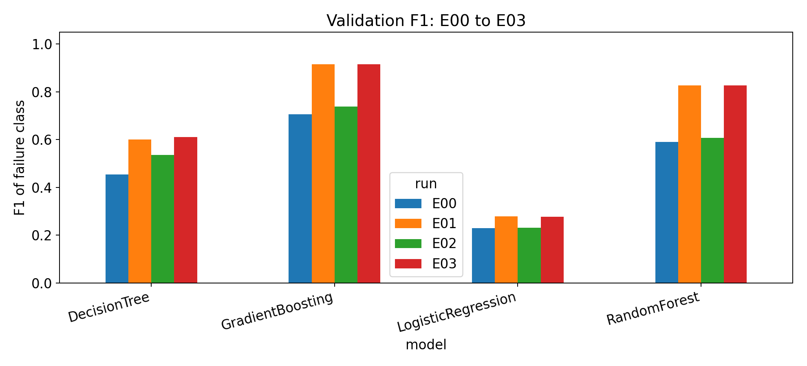

# Dự đoán lỗi thiết bị với AI4I 2020

Báo cáo tiến độ giữa kỳ môn Máy học. Dự án phân loại `Machine failure` từ Type và 5 biến vận hành. Bản nộp gồm mã nguồn, notebook, dữ liệu, báo cáo Word, PowerPoint, mô hình đã huấn luyện và kết quả có thể kiểm chứng.

## Kết quả đã chạy

Lần chạy mới nhất: **06/11/2026, 16:34–16:35 (UTC+7)**. Hoàn tất **17 mô hình** gồm 5 baseline E00 và 12 mô hình E01–E03. Nạp lại toàn bộ 17 mô hình và tính lại dự đoán, độ đo thành công. Không ghi nhận exception/warning trong các vòng fit. Sáu kiểm thử đều đạt.

| Mô hình | E00 F1 | E01 F1 | E02 F1 | E03 F1 |
|---|---:|---:|---:|---:|
| Logistic Regression | 0,2298 | 0,2787 | 0,2305 | 0,2768 |
| Decision Tree | 0,4540 | 0,6000 | 0,5366 | 0,6111 |
| Random Forest | 0,5909 | 0,8261 | 0,6067 | 0,8261 |
| Gradient Boosting | 0,7059 | 0,9149 | 0,7391 | 0,9149 |

**Đây là F1 của lớp lỗi trên validation, chưa phải kết quả test.** Gradient Boosting E01/E03 tìm được 43/51 lỗi, bỏ sót 8 và có 0 báo động giả. Các kết quả phụ thuộc một lần chia dữ liệu mô phỏng. Chạy lại cùng seed là kiểm tra tái lập, không tạo thêm bằng chứng độc lập.



## Cài đặt và chạy

Môi trường đã kiểm chứng: **Python 3.13.2**, các thư viện cố định phiên bản trong `requirements.txt`. Mở terminal tại thư mục có README này.

```powershell
python -m venv .venv
.\.venv\Scripts\python.exe -m pip install -r requirements.txt
.\.venv\Scripts\python.exe -m ai4i
```

Một lệnh thực hiện kiểm tra dữ liệu, EDA, baseline, ba đợt bổ sung, xuất hình minh chứng và nạp lại mô hình để kiểm chứng. Mặc định mỗi lần chạy tạo thư mục mới theo ngày giờ Việt Nam.

Chọn đường dẫn cụ thể khi cần:

```powershell
python -m ai4i --data data/ai4i2020.csv --output results/lan_chay_moi
python -m unittest discover -s tests -v
```

Thư mục output phải mới hoặc rỗng. Chương trình từ chối dùng lại thư mục đã có dữ liệu để tránh trộn kết quả hoặc tưởng đang chạy mới nhưng thực tế đọc cache. Bộ kết quả có sẵn tại `results/final/` không cần chạy lại để xem báo cáo.

## Cấu trúc dự án

```text
ai4i/                    Mã nguồn theo chức năng
  config.py              Tham số, lưới tìm kiếm, các đợt thực nghiệm
  data.py                Đọc, kiểm tra, chia dữ liệu, công thức đặc trưng
  models.py              Pipeline nhận trực tiếp 6 đầu vào gốc
  training.py            Huấn luyện và lưu kết quả từng mô hình
  experiments.py         Điều phối EDA và 17 mô hình
  eda.py                 Kiểm tra dữ liệu và hình EDA
  reporting.py           Hệ số, luật cây, importance, loss
  figures.py             Hình cấu trúc từ mô hình thật
  metrics.py             Các độ đo lớp lỗi
  verification.py        Nạp lại mô hình và đối chiếu kết quả
  summary.py             Bảng, ROC/PR và nhận xét tổng hợp
  storage.py             JSON, dấu vết cấu hình và bảo vệ output
  cli.py, __main__.py     Lệnh python -m ai4i
data/ai4i2020.csv         Một bản dữ liệu nguồn
notebooks/               Notebook xem kết quả và hướng dẫn chạy lại
results/final/           Một bộ kết quả mới nhất, đầy đủ
experiments/history/     Log cũ giữ lại để thể hiện tiến trình
tests/                   Các kiểm thử dữ liệu và mô hình
CHANGELOG.md             Nhật ký theo ngày
```

## Giao thức thực nghiệm

- Dữ liệu: 10.000 dòng, 14 cột, 339 mẫu lỗi (3,39%); không thiếu hay trùng toàn dòng.
- X gồm Type và 5 biến số. Loại UDI, Product ID, TWF/HDF/PWF/OSF/RNF khỏi X.
- Chia phân tầng 70/15/15, seed 42: train 7.000, validation 1.500, test 1.500. Số mẫu lỗi lần lượt 237, 51, 51.
- E00: 6 biến gốc, cấu hình ban đầu, có thêm Dummy.
- E01: thêm chênh lệch nhiệt độ, công suất ước tính và tích mòn × mô-men; giữ cấu hình gốc.
- E02: biến gốc và GridSearchCV. E03: biến mở rộng và GridSearchCV.
- CV chỉ trên train, StratifiedKFold 3 fold, shuffle=True, seed 42, refit theo F1 lớp lỗi. Hai đợt tuning có tổng 150 fit CV và 8 refit.
- Encoder/scaler fit trong pipeline hoặc từng fold train. Ngưỡng dự đoán hiện tại là 0,5. Chưa calibration hay tối ưu ngưỡng.
- Giữ nguyên 27 quan sát có target không khớp OR của các cờ mode, không sửa nhãn hoặc tự xóa điểm cực trị.

## Đầu ra và cách kiểm chứng

`results/final/experiment_log.csv` có **17 dòng**, ghi giờ bắt đầu/kết thúc theo UTC+7, mô hình, tham số, train/validation metrics, CV, FN/FP và thời gian chạy. Trường `mean_test_*` trong `cv_results.csv` chỉ là điểm fold CV bên trong train, không phải tập test giữ riêng.

Mỗi thư mục `E00`–`E03`/tên mô hình lưu:

- `model.joblib`: toàn bộ pipeline đã fit, gồm tạo đặc trưng nếu cần.
- `parameters.json`, `input_schema.json`: tham số và đầu vào.
- `metrics.json`, `train_metrics.json`: độ đo đã tính.
- `validation_predictions.csv`, `misclassified_samples.csv`: dự đoán và các mẫu FN/FP.
- `confusion_matrix.png`; với đợt tuning có thêm `cv_results.csv`, `search_grid.json`.

`eda/` có kiểm tra thiếu/trùng, thống kê biến, phân bố lớp, tương quan và 27 dòng bất nhất nhãn. `algorithm_evidence/` có minh chứng bốn thuật toán. Permutation importance đo trên các cột sau tạo đặc trưng để giữ giao thức đã báo cáo, không diễn giải như tác động nhân quả của đầu vào gốc.

`verification.json` ghi các kiểm tra nạp lại mô hình và độ đo; `metadata.json` ghi phiên bản môi trường, hash dữ liệu, hash mã và cấu hình; `completion.json` xác nhận hoàn thành. `SUMMARY.md` trình bày kết quả dễ đọc.

## Dùng mô hình đã lưu

Chạy từ thư mục gốc dự án để Python tìm được package `ai4i`:

```python
import joblib
import pandas as pd
from ai4i.config import NUM

model = joblib.load("results/final/E01/GradientBoosting/model.joblib")
raw = pd.read_csv("data/ai4i2020.csv")[["Type", *NUM]].head(3)
prediction = model.predict(raw)
probability = model.predict_proba(raw)[:, 1]
```

Đây là ví dụ cách gọi, không phải đánh giá độc lập. Không cần gọi `augment()` thủ công. Các mô hình của bản cũ chưa chứa bước tạo đặc trưng được giữ ngoài bản nộp này.

## Tài liệu và nguồn

- [Báo cáo Word](BaoCaoGiuaKy.docx)
- [PowerPoint](BaoCaoGiuaKy.pptx)
- [Nhật ký thực nghiệm mới nhất](results/final/experiment_log.csv)
- [Kết quả tổng hợp](results/final/SUMMARY.md)
- [Nhật ký đồ án](CHANGELOG.md)

Nguồn dữ liệu: [UCI AI4I 2020](https://archive.ics.uci.edu/dataset/601/ai4i+2020+predictive+maintenance+dataset), DOI 10.24432/C5HS5C, CC BY 4.0. Dữ liệu mô phỏng phục vụ học tập, không có target thời gian còn lại để khẳng định dự đoán hỏng trước một số giờ cụ thể.

Mã và tài liệu có hỗ trợ từ AI. Nhóm cần hiểu phương pháp, điền đóng góp thực tế và chịu trách nhiệm nội dung nộp.
