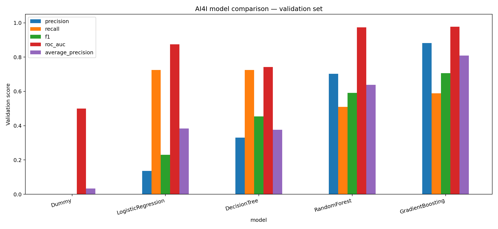

# Dự đoán lỗi thiết bị — AI4I 2020

Đồ án môn Máy học sử dụng dữ liệu vận hành để phân loại thiết bị có lỗi hay không. Hiện đã hoàn thành EDA và thực nghiệm ban đầu với 5 mô hình.

## Bài toán và dữ liệu

- Nhãn: `Machine failure` (0: không lỗi, 1: có lỗi).
- Đầu vào: Type, nhiệt độ không khí, nhiệt độ quá trình, tốc độ quay, torque và độ mòn dụng cụ.
- Dữ liệu đã kiểm tra: **10.000 mẫu, 14 cột**, không thiếu và không trùng dòng; **339 mẫu lỗi (3,39%)**.
- Không dùng UDI, Product ID hoặc các nhãn TWF/HDF/PWF/OSF/RNF làm đầu vào.
- Nguồn: [UCI AI4I 2020](https://archive.ics.uci.edu/dataset/601/ai4i+2020+predictive+maintenance+dataset). Trích dẫn: AI4I 2020 Predictive Maintenance Dataset (2020), DOI: 10.24432/C5HS5C; dữ liệu được công bố theo CC BY 4.0.

## Chạy chương trình

Yêu cầu Python và các thư viện trong requirements.txt. Đặt ai4i2020.csv cạnh file Python.

```powershell
python -m pip install -r requirements.txt
python ai4i_eda_baseline.py
```

Để lưu một lần chạy mới, tránh ghi đè kết quả cũ:

```powershell
python ai4i_eda_baseline.py --data ai4i2020.csv --output results/run_03
```

Hoặc mở `01_eda_baseline.ipynb` và chạy các ô theo thứ tự trong thư mục dự án.

## Thiết kế thực nghiệm

Chia phân tầng **70% train / 15% validation / 15% test**, seed **42**. Encoding và scaling được fit trên train trong pipeline. Các cấu hình ban đầu được cố định; chưa tối ưu tham số hoặc ngưỡng. Chỉ đánh giá validation; **chưa sử dụng test**.

## Kết quả ban đầu

Các chỉ số Precision, Recall và F1 dưới đây tính cho **lớp lỗi** trên 1.500 mẫu validation (51 mẫu lỗi). AP là Average Precision.

| Mô hình | Precision | Recall | F1 | ROC-AUC | AP | Bỏ sót | Báo động giả |
|---|---:|---:|---:|---:|---:|---:|---:|
| GradientBoosting | 0.8824 | 0.5882 | 0.7059 | 0.9772 | 0.8094 | 21 | 4 |
| RandomForest | 0.7027 | 0.5098 | 0.5909 | 0.9739 | 0.6389 | 25 | 11 |
| DecisionTree | 0.3304 | 0.7255 | 0.4540 | 0.7421 | 0.3763 | 14 | 75 |
| LogisticRegression | 0.1365 | 0.7255 | 0.2298 | 0.8750 | 0.3829 | 14 | 234 |
| Dummy | 0.0000 | 0.0000 | 0.0000 | 0.5000 | 0.0340 | 51 | 0 |



Gradient Boosting đạt F1 cao nhất trong lần chạy này: phát hiện 30/51 lỗi, bỏ sót 21 lỗi và có 4 báo động giả. Decision Tree phát hiện 37/51 lỗi nhưng có 75 báo động giả. Cần cân nhắc cả khả năng phát hiện và chi phí cảnh báo sai.

## Tổ chức tài liệu

```text
.
├── README.md                       # Giới thiệu, cách chạy, kết quả
├── CHANGELOG.md                    # Nhật ký tiến độ và cập nhật
├── ai4i_eda_baseline.py             # EDA, pipeline và 5 mô hình
├── 01_eda_baseline.ipynb            # Chạy và xem kết quả tương tác
├── requirements.txt
├── ai4i2020.csv
└── results/
    └── comparison_5_models/
        ├── experiment_log.csv      # Tham số và metrics từng mô hình
        ├── model_comparison.csv    # Bảng so sánh
        ├── model_comparison.png
        ├── NHAN_XET.md
        ├── run_metadata.json       # Phiên bản môi trường và cách chia
        ├── split_indices.csv
        └── ...                     # EDA, dự đoán và confusion matrix
```

- [Nhật ký thực nghiệm](results/comparison_5_models/experiment_log.csv)
- [Nhận xét kết quả](results/comparison_5_models/NHAN_XET.md)
- [Nhật ký cập nhật](CHANGELOG.md)

## Tiến độ và công việc tiếp theo

- [x] Kiểm tra dữ liệu và vẽ EDA.
- [x] Xây dựng pipeline và baseline.
- [x] So sánh 5 mô hình, lưu dự đoán và nhật ký.
- [ ] Cross-validation trên train và thử đặc trưng mới.
- [ ] Chọn ngưỡng cảnh báo bằng validation.
- [ ] Chốt mô hình và đánh giá test.
- [ ] Hoàn thiện báo cáo, slide và phân công thực tế của nhóm.

## Giới hạn

Dữ liệu mô phỏng và tập validation chỉ có 51 mẫu lỗi. Kết quả phản ánh phân loại trạng thái lỗi tại điểm đo, chưa chứng minh dự đoán trước thời điểm hỏng hoặc lập lịch bảo trì tối ưu. Mô hình có F1 cao nhất trên validation chưa phải kết luận cuối cùng.
